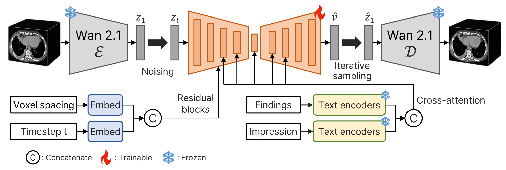
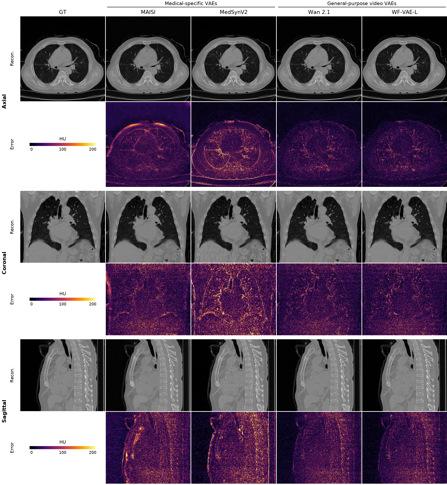
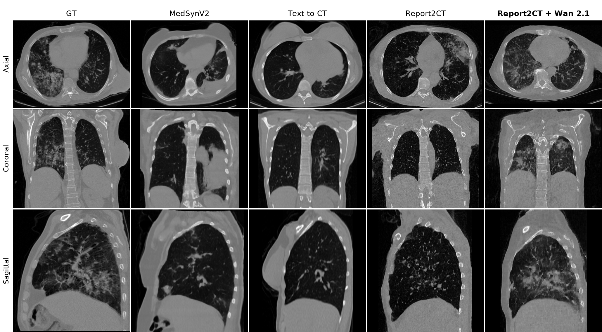

# Report2CT-Wan

**General-Purpose Video VAEs as Efficient Alternatives to Medical-Specific VAEs for Report-Conditioned 3D CT Generation**

Woojin Na, Suhyun Ahn, Hyunjun Park, Jinah Park · KAIST · ISBI 2027 (under review)



Report2CT with the frozen Wan 2.1 VAE. The encoder maps a CT volume to a latent, a diffusion UNet conditioned on voxel spacing, the timestep and the report (findings and impression) denoises it, and the decoder returns the CT volume. Only the UNet is trained.

We compare two general-purpose video VAEs (Wan 2.1, WF-VAE-L) with two medical-specific VAEs (MAISI, MedSynV2) for chest CT, and replace the MAISI VAE in Report2CT with a frozen Wan 2.1 VAE.

### Reconstruction



Axial, coronal and sagittal slices of a real CT (GT) and its reconstruction by each VAE (Recon.), with the absolute error in Hounsfield units, HU (Error).

### Report-conditioned generation



Axial, coronal and sagittal views of a real CT and of volumes generated from its report by MedSynV2, [Text-to-CT](https://github.com/danielemolino/Text2CT), Report2CT, and Report2CT with the frozen Wan 2.1 VAE (ours).

## 1. Installation

```bash
conda create -n r2ct-wan python=3.11 -y
conda activate r2ct-wan
pip install -r requirements.txt
```

## 2. Data

Download [CT-RATE](https://huggingface.co/datasets/ibrahimhamamci/CT-RATE) from Hugging Face. This repository contains no CT volumes and no report text. `<CT-RATE>` below is the `dataset` folder of the download.

## 3. VAE weights

Download the VAE checkpoints from their official sources and place them under `weights/`. Wan 2.1 can also be loaded directly by its Hugging Face repo id:

- MAISI: `models/autoencoder_v1.pt` from [nvidia/NV-Generate-CT](https://huggingface.co/nvidia/NV-Generate-CT), and a MAISI config json that defines `autoencoder_def` (for example `configs/inference.json` of the MONAI `maisi_ct_generative` bundle)
- Wan 2.1: [Wan-AI/Wan2.1-T2V-1.3B-Diffusers](https://huggingface.co/Wan-AI/Wan2.1-T2V-1.3B-Diffusers)
- WF-VAE-L (16 channels): clone [WF-VAE](https://github.com/PKU-YuanGroup/WF-VAE) and download the WF-VAE-L 16-channel checkpoint folder [chestnutlzj/WF-VAE-L-16Chn](https://huggingface.co/chestnutlzj/WF-VAE-L-16Chn)
- MedSynV2: clone [MedSynV2](https://github.com/batmanlab/MedSynV2) and download `vae.ckpt` from [batmanLab/MedSynV2](https://huggingface.co/batmanLab/MedSynV2)

MedSynV2 and WF-VAE are imported from your clones: pass their paths and install their dependencies as their READMEs describe.

## 4. VAE comparison

Run from the repository root. Every volume is resampled to 448 × 448 × 448. Pick the VAE with `--vae` and pass the paths to its weights:

| `--vae` | Paths |
|---|---|
| `maisi` (MAISI) | `--maisi-config <config.json> --maisi-ckpt weights/autoencoder_v1.pt` |
| `medsyn2` (MedSynV2) | `--medsyn2-repo <MedSynV2 clone> --medsyn2-ckpt weights/vae.ckpt` |
| `wan2.1` (Wan 2.1) | `--wan-path Wan-AI/Wan2.1-T2V-1.3B-Diffusers` (default) |
| `wf-vae` (WF-VAE-L) | `--wfvae-repo <WF-VAE clone> --wfvae-ckpt weights/<WF-VAE-L 16-channel folder>` |

Reconstruction PSNR and SSIM (HU clipped to [-1000, 1000]):

```bash
python -m vae_compare.recon --vae wan2.1 --ct-dir <CT-RATE>/valid_fixed --out-csv <out>/wan2.1_recon.csv
```

Linear probing of the 18 CT-RATE abnormality labels on frozen latents (8 × 8 × 8 average-pooled). `split.json` is `{"train": [...ids], "val": [...ids]}` with ids from `train_fixed`; the test split is every volume in `valid_fixed`:

```bash
python -m vae_compare.encode --vae wan2.1 --ct-dir <CT-RATE>/train_fixed --split-json split.json --split train --out-dir <features>
python -m vae_compare.encode --vae wan2.1 --ct-dir <CT-RATE>/train_fixed --split-json split.json --split val --out-dir <features>
python -m vae_compare.encode --vae wan2.1 --ct-dir <CT-RATE>/valid_fixed --split test --out-dir <features>
for s in 0 1 2; do
  python -m vae_compare.probe.train --vae wan2.1 --seed $s --feature-dir <features> --labels-dir <CT-RATE>/multi_abnormality_labels --out-dir <results>
done
python -m vae_compare.probe.summarize --results-dir <results>
```

## Citation

```bibtex
@misc{na2026videovae,
  title  = {General-Purpose Video {VAEs} as Efficient Alternatives to Medical-Specific {VAEs} for Report-Conditioned {3D} {CT} Generation},
  author = {Na, Woojin and Ahn, Suhyun and Park, Hyunjun and Park, Jinah},
  note   = {Under review at IEEE ISBI 2027},
  year   = {2026}
}
```

## Acknowledgements

This work was supported by the National Research Foundation of Korea (NRF) grant funded by the Ministry of Science and ICT (MSIT) (Hu-NAMs AI Center, No. RS-2026-25609011).

## License

The code in this repository is released under the [Apache License 2.0](LICENSE). Images in `assets/` are derived from [CT-RATE](https://huggingface.co/datasets/ibrahimhamamci/CT-RATE) and licensed under [CC BY-NC-SA 4.0](https://creativecommons.org/licenses/by-nc-sa/4.0/). The VAE weights are not included and keep their own licenses: MAISI (NVIDIA Open Model License), Wan 2.1 (Apache-2.0), WF-VAE (Apache-2.0) and MedSynV2 (academic, non-commercial license; cite MedSynV2 when you use its weights).
